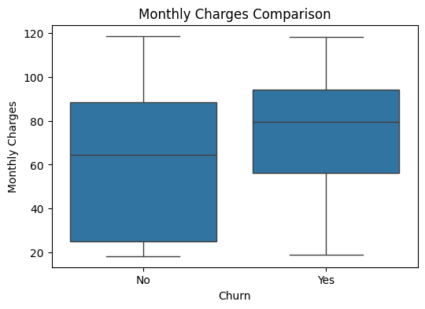

# Telco Customer Churn Prediction

> 🎓 Completed as part of the **Higher Diploma in Science in Data Analytics (QQI Level 8)** at **Dublin Business School**, 2025–2026 (graduated with First Class Honours).
*Module: Applied Data Analytics (CA1).*

This project predicts whether a telecom customer will churn using the Telco Customer dataset. The model is a regularised logistic regression (`SGDClassifier` with `log_loss`), trained with SMOTE to handle class imbalance and tuned with grid search.

## Business question
Which customers are at risk of leaving, and what characterises them? The model is tuned for **recall** so the retention team catches as many likely churners as possible.

## Dataset
- File: `Telco_Customer.csv` (public Kaggle *Telco Customer Churn* dataset, with an added `TenureBand` column created during EDA in Excel)
- Original size: 7,043 customers, 22 columns
- After cleaning: 7,032 rows (rows with missing `TotalCharges` removed)
- Target: `Churn` (`Yes` / `No`), with about **27%** of customers churned

## Tools
Python (pandas, NumPy, scikit-learn, imbalanced-learn, matplotlib/seaborn) · Excel (EDA)

## Exploratory findings
- About 27% churned and 73% stayed.
- **Month-to-month contracts** show much higher churn than one- or two-year contracts.
- **Shorter-tenure** customers churn substantially more.
- Median monthly charges: Stayed **64.43** vs Churned **79.65**. Customers who left tended to pay more per month.



## What the notebook does
1. Load and inspect the data
2. Drop `customerID`
3. Convert `TotalCharges` to numeric and drop missing values
4. Map binary categories to 0/1
5. One-hot encode: `TenureBand`, `MultipleLines`, `InternetService`, `Contract`, `PaymentMethod`
6. Scale features with `StandardScaler`
7. Train/test split (80/20, stratified)
8. Pipeline: **SMOTE → SGDClassifier (elastic-net logistic regression)**
9. `GridSearchCV` (5-fold) with **recall** as the scoring metric
10. Evaluate on the hold-out test set
11. Explore monthly charges vs churn with a boxplot

## Best hyperparameters
| Parameter | Value |
|---|---|
| `alpha` | 0.1 |
| `eta0` | 0.001 |
| `l1_ratio` | 1 |
| `max_iter` | 100 |

Cross-validated recall (best model): **0.871**

## Test-set results
| Class | Precision | Recall | F1 |
|---|---|---|---|
| No churn (0) | 0.95 | 0.57 | 0.71 |
| Churn (1) | 0.43 | **0.91** | 0.59 |

- Accuracy: 0.66
- The model was tuned to catch churners (high recall on class 1), so it flags more customers as at-risk and has more false positives. That's an acceptable trade-off when a retention offer costs less than losing a customer.

## How to run
```bash
pip install -r requirements.txt
jupyter notebook Applied_Data_Analytics.ipynb
```

## Author
Jean Ly Kon · [LinkedIn](https://www.linkedin.com/in/jeankly) · [GitHub](https://github.com/jennykonjl)
